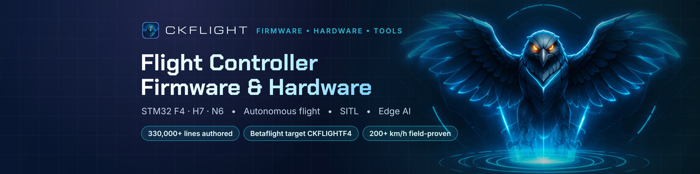
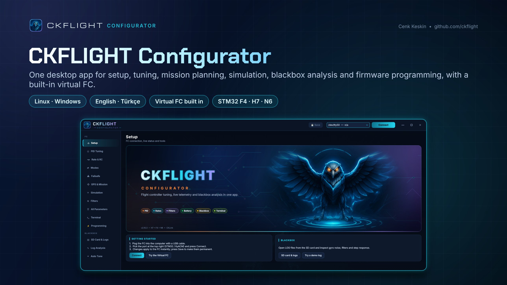
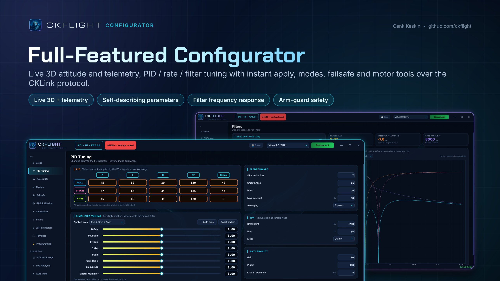
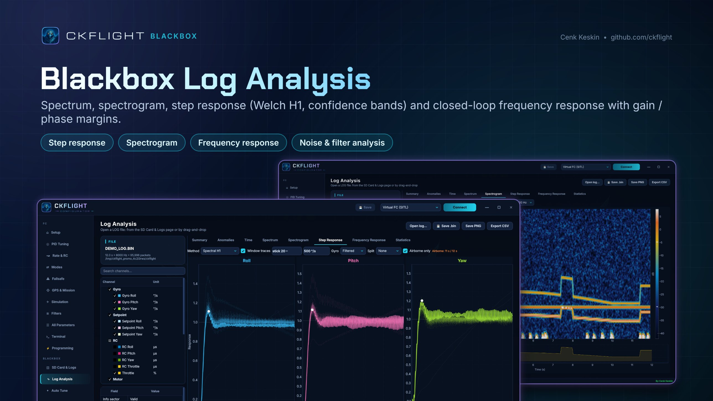
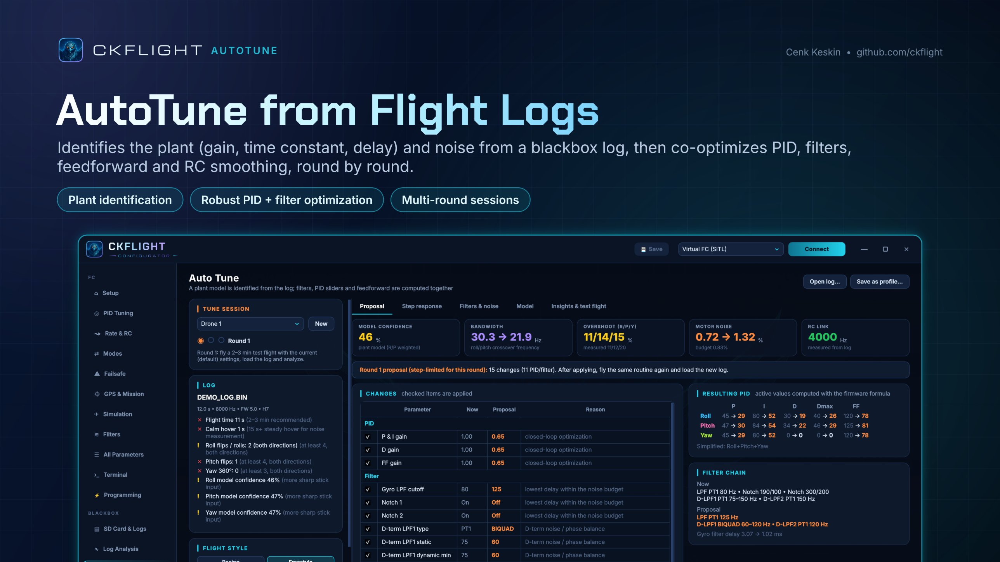
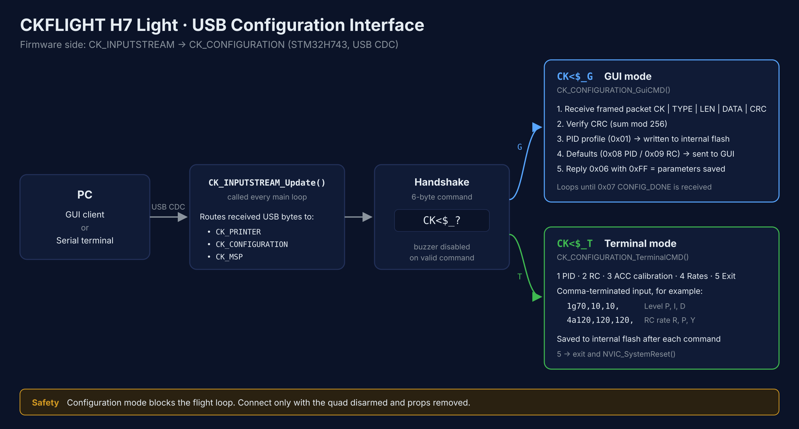
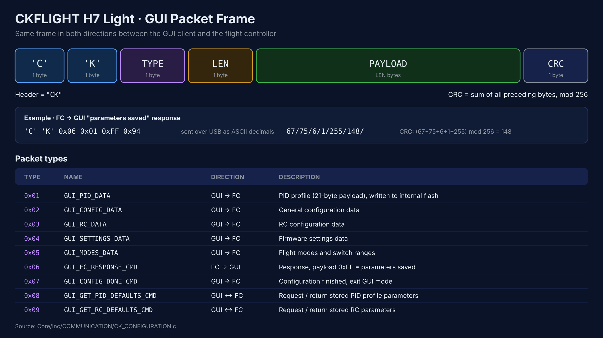
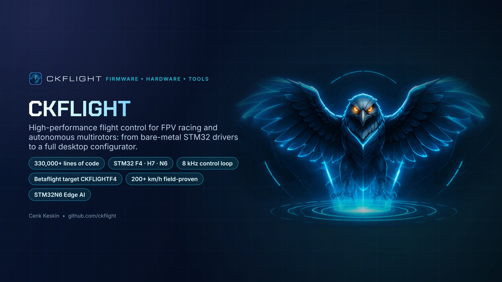

# CKFLIGHT H7 Advanced Flight Controller Firmware (Light Version) as a STM32CubeIDE Project


I have decided to upload the lighter version of my flight controller firmware: High-performance bare-metal 16K loop time capable STM32H7 flight controller firmware close to betaflight in flight performance developed by me for educational, hobbyist, and academic use.

STM32CubeIDE is a great environment for easy debugging without getting into unnecessary details. 

Commercially available flight controller boards can be used with this firmware: Check Board Porting and Configuration Guide below.

CKFLIGHT H7 is designed as a simplified and readable version of the full CKFLIGHT firmware architecture while preserving modern flight-controller concepts including high-rate control loops, sensor fusion, digital ESC protocols, SD logging, USB communication, advanced PID algorithms, and real-time embedded control systems.

The firmware targets STM32H743-based flight controllers and is implemented using STM32CubeIDE without an RTOS.

The project is intended to provide both:

- A real usable flight-controller firmware
- A readable educational embedded systems reference

The architecture focuses on exposing low-level implementation details rather than hiding functionality behind large abstraction layers.

---

# Features

- Bare-metal STM32H743 firmware architecture
- High-rate real-time flight control loops
- Advanced PID controller implementation
- IMU sensor fusion and attitude estimation
- DSHOT ESC protocol support
- RC receiver protocols
  - SBUS
  - CRSF
- USB communication interface
- MSP communication support
- USB GUI and terminal configuration interface
- Companion desktop app: [CKFLIGHT Configurator](#ckflight-configurator)
- SD card flight data logging
- GPS support
- Barometer support
- Magnetometer support
- OSD support
- SmartAudio VTX control
- DMA-based peripheral handling
- SPI / UART / I2C driver stack
- Blackbox-style logging infrastructure
- Runtime telemetry and configuration systems
- Modular firmware structure for learning and development
- STM32CubeIDE project structure
- Real-time fault detection and debugging infrastructure

---

# Flight Control Firmware Details

The firmware contains a complete modern flight-control stack including:

- Real-time PID control system
- Attitude estimation and sensor fusion
- Gyroscope and accelerometer filtering
- RC input processing
- Motor mixer implementation
- DSHOT motor output generation
- Failsafe handling
- Arming and safety logic
- Navigation and altitude control infrastructure
- GPS integration
- Blackbox-style SD card logging
- USB telemetry and configuration interface
- Runtime communication systems
- Fault detection and debugging infrastructure

The control architecture is designed for:

- Low latency
- High loop-rate operation
- Deterministic timing
- Minimal software overhead
- Direct hardware-level control

The project focuses on readable implementation of real flight-controller concepts rather than excessive abstraction layers.

The firmware performance and architecture are designed to be conceptually comparable to modern high-performance open-source flight-controller firmware while remaining easier to study and modify.

---

# Real Flight Video

https://github.com/user-attachments/assets/4c7df17b-40bc-41f8-9e52-42024572642d

---

# Terminal Interface

https://github.com/user-attachments/assets/535e39e9-0e48-4be0-abaf-20bba0b0e894


---

# CKFLIGHT Configurator



CKFLIGHT Configurator is a single desktop app for setup, tuning, mission planning, simulation, blackbox analysis and firmware programming, with a built-in virtual flight controller.

| | |
|---|---|
| Platforms | Linux, Windows |
| Languages | English, Türkçe |
| Targets | STM32 F4, H7, N6 |
| Virtual FC | Built-in SITL, selectable as **Virtual FC (SITL)** in the port list |
| Protocol | CKLink |

> The screenshots show the Configurator running against its built-in Virtual FC (SITL · H7 · FW 5.0.0) over CKLink. The light firmware in this repository has its own simpler USB configuration interface, described in [USB Configuration Interface (Light Firmware)](#usb-configuration-interface-light-firmware).

## Pages

| Group | Page | Purpose |
|-------|------|---------|
| FC | Setup | FC connection, live status and tools |
| FC | PID Tuning | PID table, simplified tuning, feedforward, TPA and anti gravity |
| FC | Rate & RC | Rates and RC settings |
| FC | Modes | Flight modes |
| FC | Failsafe | Failsafe settings |
| FC | GPS & Mission | GPS and mission planning |
| FC | Simulation | Simulation with the built-in Virtual FC |
| FC | Filters | Gyro low-pass and notch filters with frequency response |
| FC | All Parameters | Full parameter list |
| FC | Terminal | FC terminal |
| FC | Programming | Firmware programming |
| Blackbox | SD Card & Logs | Open LOG files from the SD card |
| Blackbox | Log Analysis | Spectrum, spectrogram, step response and frequency response |
| Blackbox | Auto Tune | PID and filter proposals from flight logs |

## Getting Started

1. Plug the FC into the computer with a USB cable.
2. Pick the port at the top right (STM32 / ttyACM) and press **Connect**.
3. Changes apply to the FC instantly; press **Save** to make them permanent.

No hardware at hand? Choose **Try the Virtual FC** or **Try a demo log** on the Setup page.

## Tuning



Live 3D attitude and telemetry, PID / rate / filter tuning with instant apply, modes, failsafe and motor tools over the CKLink protocol. Highlights: live 3D + telemetry, self-describing parameters, filter frequency response and arm-guard safety.

- **PID table:** P, I, D, FF and Dmax for roll, pitch and yaw. Typing a value into the table turns simplified tuning off.
- **Simplified tuning (Betaflight method):** sliders scale the default PIDs: D gain, P & I gain, FF gain, D max, I gain, Pitch:Roll D, Pitch P·I·FF and master multiplier. Applied axes are selectable, with **Auto tune** and **Reset sliders** buttons.
- **Feedforward:** jitter reduction, smoothness, boost, max rate limit and averaging.
- **TPA:** breakpoint, rate and mode, reducing gain as throttle rises.
- **Anti gravity:** gain, P gain and cutoff frequency.
- **Filters:** gyro low-pass and notch filters drawn as a frequency response over the unfiltered gyro noise of an open log, with filter delay, attenuation at 100 Hz and gyro sampling rate.
- **Arm-guard safety:** while the FC is armed the header shows **ARMED — settings locked** and settings are locked.

## Blackbox Log Analysis



Spectrum, spectrogram, step response (Welch H1 with confidence bands) and closed-loop frequency response with gain / phase margins.

- Open a LOG file from the **SD Card & Logs** page or by drag-and-drop.
- Tabs: Summary, Anomalies, Time, Spectrum, Spectrogram, Step Response, Frequency Response, Statistics.
- Searchable channel tree for gyro, setpoint, RC, throttle and motor data.
- Step response options: method (Spectral H1), window, filtered gyro, split and airborne-only segments.
- Export with **Save .bin**, **Save PNG** and **Export CSV**.

## AutoTune from Flight Logs



AutoTune identifies the plant (gain, time constant, delay) and noise from a blackbox log, then co-optimizes PID, filters, feedforward and RC smoothing, round by round.

- **Tune sessions** per drone, in multiple rounds: fly a 2–3 min test flight, load the log, apply the proposal, then fly the same routine again and load the new log.
- **Log checks** before tuning: flight time, a calm hover of 15 s or more for noise measurement, roll and pitch flips in both directions, yaw 360° turns and per-axis model confidence.
- **Flight style:** Racing or Freestyle.
- **Proposal:** every PID and filter change is listed with its current value, proposed value and reason; checked items are applied.
- **Metrics:** model confidence, roll/pitch crossover bandwidth, overshoot per axis, motor noise against its budget and measured RC link rate.
- **Results:** resulting PIDs computed with the firmware formula, and the resulting filter chain with gyro filter delay.
- Tabs: Proposal, Step response, Filters & noise, Model, Insights & test flight. Results can be saved as a profile.

## USB Configuration Interface (Light Firmware)

The light firmware in this repository supports two configuration modes on the same USB port:

| Mode | Handshake (6 bytes) | Used by |
|------|---------------------|---------|
| GUI configuration | `CK<$_G` | GUI client |
| Terminal configuration | `CK<$_T` | Any serial terminal (menu driven) |

When a valid handshake is received the buzzer is disabled and the firmware enters the selected configuration mode.

> **Safety:** Configuration mode runs a blocking loop on the flight controller, so the flight loop does not run while configuring. Always connect with the quad disarmed and props removed.



### GUI Packet Protocol

All GUI packets use the same frame structure:

```text
'C' 'K' | TYPE (1 byte) | LEN (1 byte) | PAYLOAD (LEN bytes) | CRC (1 byte)
```

`CRC` is the sum of all preceding bytes (header, type, length and payload) modulo 256. Responses from the flight controller are sent as ASCII decimal values separated by `/`.



| Type | Name | Direction | Description |
|------|------|-----------|-------------|
| `0x01` | `GUI_PID_DATA` | GUI → FC | PID profile parameters (21-byte payload), saved to flash |
| `0x02` | `GUI_CONFIG_DATA` | GUI → FC | General configuration data |
| `0x03` | `GUI_RC_DATA` | GUI → FC | RC configuration data |
| `0x04` | `GUI_SETTINGS_DATA` | GUI → FC | Firmware settings data |
| `0x05` | `GUI_MODES_DATA` | GUI → FC | Flight modes and switch ranges (acro, level, GPS rescue, ...) |
| `0x06` | `GUI_FC_RESPONSE_CMD` | FC → GUI | Response packet, payload `0xFF` = parameters saved |
| `0x07` | `GUI_CONFIG_DONE_CMD` | GUI → FC | Configuration finished, exits GUI mode |
| `0x08` | `GUI_GET_PID_DEFAULTS_CMD` | GUI ↔ FC | Request / return default PID profile parameters |
| `0x09` | `GUI_GET_RC_DEFAULTS_CMD` | GUI ↔ FC | Request / return default RC parameters |

In this light version, PID profile packets are written to flash; config, RC, settings and modes packets are acknowledged with the saved response and are reserved for the full CKFLIGHT firmware.

#### PID Profile Parameters (`0x01` / `0x08`)

```text
TPA             -> tpa_breakpoint (16-bit), tpa_rate, tpa_mode
Anti Gravity    -> anti_gravity_gain, anti_gravity_p_gain, anti_gravity_cutoff_hz
Simplified Tune -> simplified_pids_mode, simplified_master_multiplier,
                   simplified_pi_gain, simplified_i_gain, simplified_d_gain,
                   simplified_d_max_gain, simplified_feedforward_gain,
                   simplified_roll_pitch_ratio, simplified_pitch_pi_gain
Feedforward     -> feedforward_averaging, feedforward_max_rate_limit,
                   feedforward_smooth_factor, feedforward_jitter_factor,
                   feedforward_boost
```

#### RC Parameters (`0x09`)

```text
Deadband        -> deadband, yaw_deadband, midrc (16-bit)
Rate Limits     -> rate_limit[ROLL, PITCH, YAW] (16-bit each)
Rates           -> rcRates[RPY], rcExpo[RPY], rates[RPY]
RC Smoothing    -> rc_smoothing_mode, rc_smoothing_setpoint_cutoff,
                   rc_smoothing_feedforward_cutoff, rc_smoothing_throttle_cutoff,
                   rc_smoothing_debug_axis, rc_smoothing_auto_factor_rpy,
                   rc_smoothing_auto_factor_throttle
```

### Terminal Configuration Menu

After sending `CK<$_T`, the flight controller prints a configuration menu:

```text
1. PID Configuration
   1a.Roll  1b.Pitch  1c.Yaw  1d.Althold  1e.Velocity  1f.Navigation
   1g.Level  1h.Horizon  1i.Dmin  1j.FeedForward  1k.TPA_Breakpoint  1l.TPA_Rate
2. RC Configuration
   2a.RC_Idle_Drift  2b.RC_Idle_Trim  2c.Yaw_Deadband
3. Accelerometer Calibration
4. RC Rates Configuration
   4a.RC_Rate  4b.RC_Expo  4c.Rates
5. Exit
```

Values are entered as comma-terminated lists:

```text
1g70,10,10,      -> Level P, I, D = 70, 10, 10
1l40,            -> TPA rate = 40
4a120,120,120,   -> RC rate roll, pitch, yaw = 120
```

Selecting `5` exits configuration and restarts the flight controller.

### Parameter Storage

Parameters are stored in the MCU's internal flash (`Core/Inc/COMMUNICATION/CK_CONFIGURATION.h`):

| Block | Size |
|-------|------|
| Configuration ID (`CK<$`) | 20 bytes |
| PID parameters | 50 bytes |
| Accelerometer calibration | 6 bytes |
| RC parameters | 30 bytes |
| SD logging parameters | 10 bytes |

On first boot after an erase, `CK_CONFIGURATION_Init()` writes the default parameters once and sets the configuration ID.

---

# Supported Hardware

Primary target:

- STM32H743 flight controller platforms

Supported sensors currently present in firmware:

## IMUs
- ICM20602_GYRO,
- ICM45686_GYRO,
- ICM42688P_GYRO,
- L3GD20H_GYRO,
- ICM42605_GYRO,
- IIM42652_GYRO,
- MPU6000_GYRO,
- ICM20602_ACC,
- ICM45686_ACC,
- ICM42688P_ACC,
- IIM42652_ACC,
- LSM303D_ACC,
- FXOS8700CQ_ACC,
- ICM42605_ACC,
- MPU6000_ACC,
- BNO055_IMU

## Magnetometers
- MAG3110_MAGNETO,
- LSM303D_MAGNETO,
- FXOS8700CQ_MAGNETO,
- HMC5983_MAGNETO,
- QMC5883L_MAGNETO,
- MLX90393_MAGNETO,

## Barometers
- MS5607_BAROMETER,
- BMP280_BAROMETER,
- MS5611_BAROMETER,
- DPS310_BAROMETER,

## GPS
- GPS_UBLOX7,
- GPS_UBLOX8,
- M10 Series

## SPI Flash and SPI/SDIO SD Card

Use this log analysis tool i have written for flight log analysis: https://github.com/ckflight/Flight_Log_Tools

Blackbox logs can also be analyzed in [CKFLIGHT Configurator](#blackbox-log-analysis).


---

# Board Porting and Configuration Guide

CKFLIGHT H7 is designed so that custom STM32H7 flight-controller boards and commercially available Betaflight-style flight controllers can be adapted through configuration headers.

The main configuration files are:

```text
Core/Inc/CK_DEFINITIONS.h
Core/Inc/CK_SETTINGS.h
Core/Inc/config/
```

---

## Board Selection


`CK_DEFINITIONS.h` selects the target board and MCU family.

Example:

```c
#define CKFLIGHT_F4 false
#define CKFLIGHT_H7 true
#define KAKUTE_H7_1v3 false
#define MATEKH743_SLIMV3 false
#define RF_REVOLT false
```

Only one target board should be enabled at a time.

Currently included board targets include:

```text
CKFLIGHT_H7
KAKUTE_H7_v1.3
MATEKH743_SLIMV3
CKFLIGHT_F4
RF_REVOLT
```

Each board target includes its own pin/peripheral configuration from:

```text
Core/Inc/config/
```

To port the firmware to another Betaflight-compatible STM32H7 flight controller:

1. Add a new board definition in `CK_DEFINITIONS.h`
2. Create a matching board config header in `Core/Inc/config/`
3. Map the correct SPI, UART, I2C, timer, motor, receiver, OSD, LED, buzzer, ADC, and chip-select pins
4. Select the required sensors and peripherals in `CK_SETTINGS.h`
5. Verify interrupt priorities, DMA usage, and timer assignments
6. Build and flash using STM32CubeIDE

---

## Feature and Peripheral Selection

`CK_SETTINGS.h` enables or disables firmware modules depending on the hardware.

Examples:

```c
#define GYRO1_SPI_ 1
#define ACC1_SPI_ 1
#define GYRO2_SPI_ 0
#define ACC2_SPI_ 0

#define USE_BARO_ 0
#define USE_MAG_ 0
#define GPS_ 1

#define LOG_SPI_ 1
#define LOG_SDIO_ 0
#define LOG_FLASH_ 0

#define SBUS_ 0
#define CRSF_ 1

#define OSD_DJI_ 1
#define RGB_ 1
#define LED1_ 1
```

This allows the same firmware architecture to be adapted to different flight-controller layouts.

---

## Flight Performance Options

Advanced flight-performance features are enabled from `CK_SETTINGS.h`.

Currently supported options include:

```c
#define USE_DSHOT
#define USE_RC_SMOOTHING_FILTER
#define USE_AIRMODE_LPF
#define USE_ITERM_RELAX
#define USE_ABSOLUTE_CONTROL
#define USE_DYN_LPF
#define USE_INTEGRATED_YAW_CONTROL
#define USE_AIRMODE
#define USE_GYRO_OVERFLOW_CHECK
#define USE_THROTTLE_BOOST
#define USE_FEEDFORWARD
#define USE_TPA_MODE
#define USE_D_MAX
#define USE_ACC
#define USE_THRUST_LINEARIZATION
#define USE_SIMPLIFIED_TUNING
```

These features provide a modern control architecture similar in concept to high-performance open-source flight-controller firmware.

---

## Sensor Orientation and Mixer Setup

Sensor orientation and motor mixer configuration are also controlled from `CK_SETTINGS.h`.

Example:

```c
#define GYRO_ORIENTATION_X_SIGN 1
#define GYRO_ORIENTATION_Y_SIGN 1
#define GYRO_ORIENTATION_Z_SIGN -1
#define GYRO_ORIENTATION_SWAP_XY false

#define ACC_ORIENTATION_X_SIGN 1
#define ACC_ORIENTATION_Y_SIGN 1
#define ACC_ORIENTATION_Z_SIGN 1

#define MIXER_ORIENTATION 3
#define MIXER_ESC_REVERSED true
```

These settings must be checked carefully when using a different frame layout, IMU orientation, or ESC mounting direction.

---

## Important Porting Notes

Before flying on a new board:

- Verify all motor outputs with props removed
- Confirm gyro and accelerometer orientation
- Confirm receiver channel mapping
- Confirm arming, failsafe, and motor stop behavior
- Confirm battery voltage/current ADC scaling
- Confirm DSHOT/timer/DMA assignments
- Confirm SD card or flash logging configuration
- Confirm OSD, GPS, buzzer, LED, and telemetry peripherals
- Test sensor data over USB before enabling flight

This firmware is intended as a technical and educational reference. Hardware-specific validation is required before flight use.

---

# Firmware Architecture

```text
Core/
├── Inc/
│   ├── COMMON/
│   ├── COMMUNICATION/
│   ├── DRIVERS/
│   ├── FLASH/
│   ├── FLIGHT/
│   ├── MOTION/
│   ├── OSD/
│   ├── SENSORS/
│   ├── config/
│   ├── CK_DEFINITIONS.h
│   ├── CK_SETTINGS.h
│   ├── NOTES.txt
│   ├── firmware_notes.txt
│   ├── git_commit_hash.h
│   ├── git_hash.py
│   ├── main.h
│   ├── stm32h7xx_hal_conf.h
│   └── stm32h7xx_it.h
│
├── Src/
│   ├── COMMUNICATION/
│   ├── DRIVERS/
│   ├── FLASH/
│   ├── FLIGHT/
│   ├── MOTION/
│   ├── OSD/
│   ├── SENSORS/
│   ├── FATFS/
│   ├── USB_DEVICE/
│   ├── main.c
│   ├── stm32h7xx_hal_msp.c
│   ├── stm32h7xx_it.c
│   └── system_stm32h7xx.c
│
└── Startup/
    └── startup_stm32h743xx.s
```

---

## Main Firmware Modules

```text
FLIGHT/         -> PID, mixer, RC processing, navigation, failsafe
SENSORS/        -> IMU, barometer, magnetometer drivers
DRIVERS/        -> SPI, UART, I2C, ADC, DMA, GPIO
COMMUNICATION/  -> MSP, USB CDC, telemetry, configurator protocol
OSD/            -> On-screen display
FLASH/          -> Flash memory handling
MOTION/         -> Motion estimation and filtering
FATFS/          -> SD card filesystem and logging
```

The project prioritizes:

- Readability
- Real-time determinism
- Low-level hardware understanding
- Educational value
- Minimal abstraction overhead

---

# Development Environment

- STM32CubeIDE
- STM32 HAL drivers
- STM32H7 series MCU
- Bare-metal architecture (no RTOS)

---

# Design Goals

This project was developed to provide:

- A readable modern flight-controller firmware
- A learning-oriented STM32H7 embedded architecture
- A practical reference for:
  - Sensor fusion
  - PID control
  - Real-time embedded systems
  - DMA-driven communication
  - Digital motor protocols
  - Flight logging systems

Unlike highly abstracted production firmware stacks, this repository focuses on exposing low-level implementation details for educational and research purposes.

---

# Current Status

The firmware includes:

- Real flight-control infrastructure
- Sensor drivers
- Communication stacks
- Logging systems
- USB interfaces
- Real-time control architecture

Development is ongoing.

---

# Repository Purpose

This repository is published as:

- Educational reference
- Embedded systems learning resource
- Flight-controller architecture example
- STM32H7 real-time firmware reference
- Personal engineering portfolio project

---

# License

This project is licensed under the GNU General Public License v3.0 (GPLv3).

You are free to use, modify, and distribute this software under the terms of the GPLv3 license. Any distributed modifications or derivative works must also be released under the same license and include source code.

For full license text:
https://www.gnu.org/licenses/gpl-3.0.html

---

# Author



Cenk Keskin

GitHub:
https://github.com/ckflight/CKFLIGHT-H7