<p align="center">
  <picture>
    <source media="(prefers-reduced-motion: reduce)" srcset="docs/images/banner.png">
    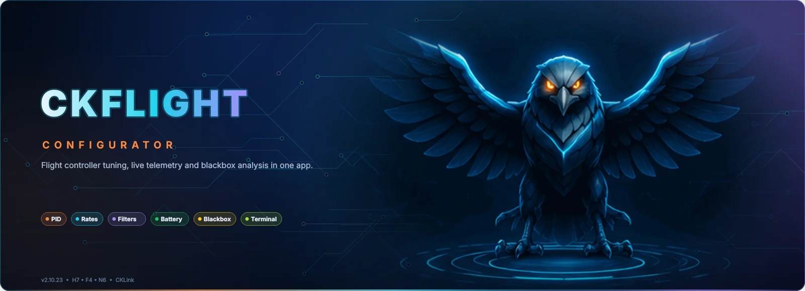
  </picture>
</p>

<h3 align="center">Flight controller firmware, hardware and tools, built from the registers up.<br>One STM32 codebase, its own desktop Configurator, and a simulator that flies the real firmware.</h3>

<p align="center">
  
  
  
  
  
  
  
</p>

> [!NOTE]
> **This repository is a light, sample version of CKFLIGHT.**
> The STM32 firmware here is a lighter version of the full CKFLIGHT firmware, shared as an example. It keeps the racing character of CKFLIGHT: with proper tuning it flies at speeds above 200 km/h with excellent performance. **It is designed as a STM32CubeIDE project for educational and learning purposes, making it easy to debug.**
>
> It shares the core safety and flight path of the full firmware: synchronous DShot output with a 250 ms output guard and an interrupt-free emergency stop in every fault handler, edge-triggered arming with throttle check, a double-buffered CRSF receiver, and link-loss failsafe (drop after 1 s, or LQ ≤ 5 % for 1 s). It also includes switch-only navigation: altitude hold, position hold (needs a barometer and magnetometer), GPS rescue (return-to-home) and landing, built on an accelerometer + GPS (+ barometer) position estimator. Navigation never engages on its own; moving roll or pitch during return-to-home or landing hands control straight back to the pilot.
>
> Not included in this light version: missions, autonomous failsafe (return-to-home on link loss), the CKLink configurator protocol and the simulator.

<p align="center">
  <a href="#-highlights">Highlights</a> •
  <a href="#-safety-first">Safety</a> •
  <a href="#-control-loop">Control loop</a> •
  <a href="#-configurator">Configurator</a> •
  <a href="#-autotune">AutoTune</a> •
  <a href="#-blackbox">Blackbox</a> •
  <a href="#-simulator">Simulator</a> •
  <a href="#-architecture">Architecture</a> •
  <a href="#-supported-hardware">Hardware</a> •
  <a href="#-getting-started">Getting started</a>
</p>

## 🎥 Real flight

https://github.com/user-attachments/assets/4c7df17b-40bc-41f8-9e52-42024572642d

## 📊 At a glance

<table>
<tr>
<td align="center" width="16%"><h2>3</h2><sub>STM32 families<br>F4 · H7 · N6</sub></td>
<td align="center" width="16%"><h2>8 kHz</h2><sub>gyro → PID → DShot<br>on H7 and N6</sub></td>
<td align="center" width="16%"><h2>141</h2><sub>live parameters<br>self-described over USB</sub></td>
<td align="center" width="16%"><h2>3</h2><sub>independent motor<br>safety layers</sub></td>
<td align="center" width="16%"><h2>20</h2><sub>simulator<br>scenarios</sub></td>
<td align="center" width="16%"><h2>1</h2><sub>codebase for every<br>board and the SITL</sub></td>
</tr>
</table>

<p align="center">
  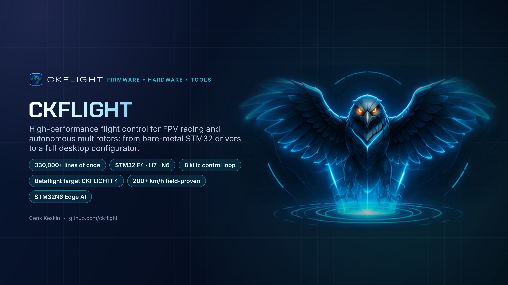
</p>

## ✨ Highlights

<table>
<tr>
<td width="50%" valign="top">

### Flight control
- Bare-metal on F4 and H7, highest-priority ThreadX thread on N6
- One codebase for STM32F4, STM32H7 and STM32N6
- **8 kHz** gyro, PID and DShot on H7 and N6, **4 kHz** on `CKFLIGHTF4_V4`
- PID with feedforward, TPA, anti-gravity, I-term relax, D-max and simplified tuning
- Gyro low-pass, two notch filters and D-term low-pass filters
- Mahony attitude estimation at 500 Hz
- Betaflight axis and sign conventions
- DShot600 and PWM ESC output, BLHeli passthrough

</td>
<td width="50%" valign="top">

### Safety
- DShot sent by the flight loop itself, in sync with the mixer
- Output guard stops the motors if the loop hangs
- Every fault handler sends STOP frames without needing interrupts
- STOP before rebooting
- Arming only on a switch edge with throttle low
- Connecting the Configurator disarms an armed FC and blocks arming
- No autonomy unless the pilot selects it with a switch

</td>
</tr>
<tr>
<td width="50%" valign="top">

### Autonomy
- Altitude hold and position hold
- Waypoint missions, return-to-home and automatic landing
- Delay-compensated estimator fusing accelerometer, GPS and barometer
- Link-loss failsafe: drop, land or return home
- Battery failsafe: warn, land or return home
- Dead-reckoning home when GPS is lost
- Capability tiers: the firmware only offers what the enabled sensors can support

> Autonomous modes are verified in simulation. Field testing is in progress.

</td>
<td width="50%" valign="top">

### Tooling, logging, connectivity
- Desktop Configurator with live telemetry and a 3D model
- CKLink protocol with a self-describing parameter table
- Blackbox on SD card or SPI flash, analysis built into the app
- AutoTune from flight logs
- ST-LINK, USB DFU and STM32N6 external-flash programming from the app
- CRSF and SBUS receivers, GPS, barometer, magnetometer
- OSD, SmartAudio VTX control, RGB LED strip, USB and MSP

</td>
</tr>
</table>

---

## 🛡 Safety first

A flight controller drives propellers that can cause serious injury, so the motor output is built so that **the motors never keep spinning when the firmware is no longer in control**.

<p align="center">
  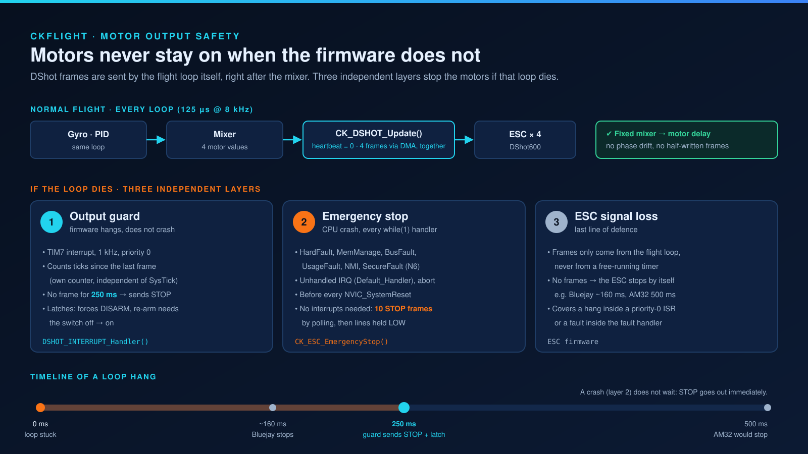
</p>

### How the motor output works

DShot frames are sent **only by the flight loop**, right after the mixer, the same way Betaflight does it. There is no free-running timer that keeps repeating the last throttle value. This gives a fixed mixer-to-motor delay with no phase drift, and DMA buffers are never rewritten while a frame is on the wire.

If the loop stops, three independent layers take over:

| Layer | Covers | What it does | Response time |
|---|---|---|---|
| **1 · Output guard** | The firmware hangs but does not crash: stuck `while` loop, unresponsive sensor, blocked thread | TIM7 interrupt at priority 0 counts the time since the last frame. It uses its own counter, not SysTick, so it still works when SysTick is blocked. It sends STOP and latches: the FC disarms, and the arm switch must be cycled. | 250 ms |
| **2 · Emergency stop** | CPU faults and every dead-end handler: HardFault, MemManage, BusFault, UsageFault, NMI, SecureFault (N6), unhandled IRQ, `abort`, and before rebooting | Sends 10 STOP frames by polling the hardware directly (interrupts are not needed), then holds the signal lines low | Immediate |
| **3 · ESC signal loss** | A hang inside a priority-0 interrupt, or a fault inside the fault handler | Because frames only come from the loop, the ESC sees silence and stops by itself | ESC firmware, e.g. Bluejay ~160 ms, AM32 500 ms |

The guard timeout was chosen against real ESC firmware: it acts after Bluejay already would, so it never cuts motors that Bluejay would have kept, and before AM32, so stopping no longer depends on the ESC's settings. Disarmed pauses, such as saving settings to flash, only send STOP and never trip the latch.

The firmware reports guard trips and skipped frames on the terminal health line (`x`). In normal flight that field never appears.

### Arming, disarming and failsafe

<p align="center">
  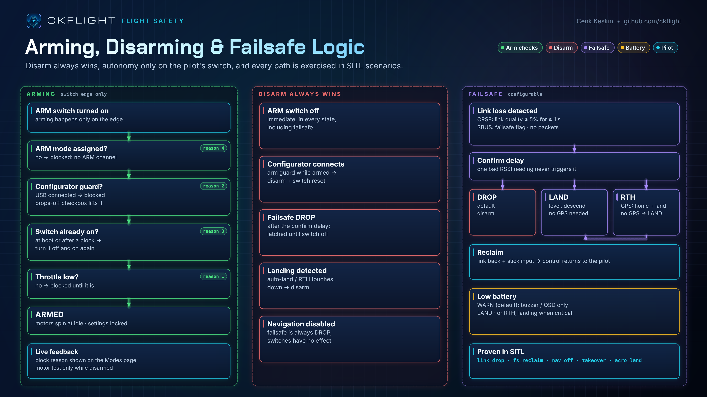
</p>

- **Arming** happens only at the moment the arm switch is turned on, with throttle low. Powering up with the switch on, or arming with throttle high, is refused until the switch is cycled.
- **Disarming** always wins: turning the arm switch off disarms immediately, including during failsafe.
- **Configurator connected:** an armed FC disarms as soon as the Configurator connects over USB, and arming stays blocked while it is connected.
- **Link loss** is declared when CRSF link quality stays below 5 % for 1 second. The response is configurable in the Failsafe tab:

| Setting | Link loss | Low battery |
|---|---|---|
| Default | `DROP`: disarm after the delay, no autonomy | `WARN`: buzzer and OSD only |
| Option | `LAND`: hold level and descend slowly (no GPS needed) | `LAND` at critical voltage |
| Option | `RTH`: return home with GPS, otherwise land | `RTH` at low voltage, land at critical |

- **No autonomy without the pilot:** autonomous modes are only engaged by a switch.
- **Level from any attitude:** when failsafe or the pilot commands level, the aircraft recovers even from inverted or 90° on its side. The simulator checks this every run (`inv_fs`, `flip_level`).

---

## ⚙ Control loop

<p align="center">
  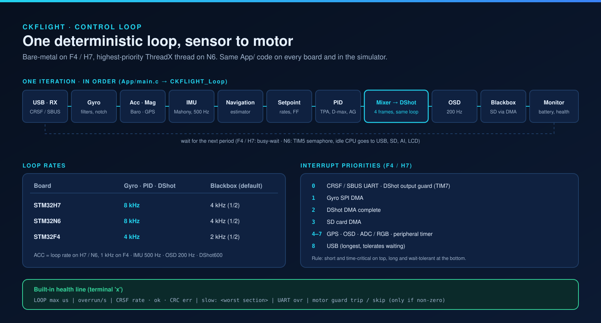
</p>

Each iteration runs the same steps in the same order, on every board and in the simulator: receiver, gyro, accelerometer, magnetometer, barometer, GPS, IMU, navigation, setpoint, PID, mixer and DShot, then OSD, blackbox and monitoring. The loop then waits for the next period. On N6 it sleeps on a TIM5 semaphore, so idle CPU time goes to USB, SD, AI and the LCD.

| Board | Gyro · PID · DShot | Accelerometer | Blackbox (default) |
|---|---|---|---|
| STM32H7 | 8 kHz | 8 kHz | 4 kHz (1/2) |
| STM32N6 | 8 kHz | 8 kHz | 4 kHz (1/2) |
| STM32F4 | 4 kHz | 1 kHz | 2 kHz (1/2) |

Interrupt priorities follow one rule: short and time-critical on top, long and wait-tolerant at the bottom. The CRSF UART and the DShot output guard are at the top, USB is at the bottom.

**Built-in diagnostics.** The terminal command `x` prints one health line every 500 ms:

```text
LOOP max us: 116 | target us: 125 | overrun/s: 0 | overrun total: 142 | CRSF rate Hz: 994 | CRSF ok total: 45104 | CRC err/s: 0 | CRC err total: 1 | UART ovr: 0
```

It shows the longest loop, overruns per second, receiver packet rate and errors, and the slowest code section when a loop overruns. Motor guard trips and skipped DShot frames appear only if they ever happen.

---

## 🖥 Configurator

Everything you need to set up, tune and analyse the aircraft is in one app. Changes apply to the flight controller instantly, and **Save** makes them permanent.

<p align="center">
  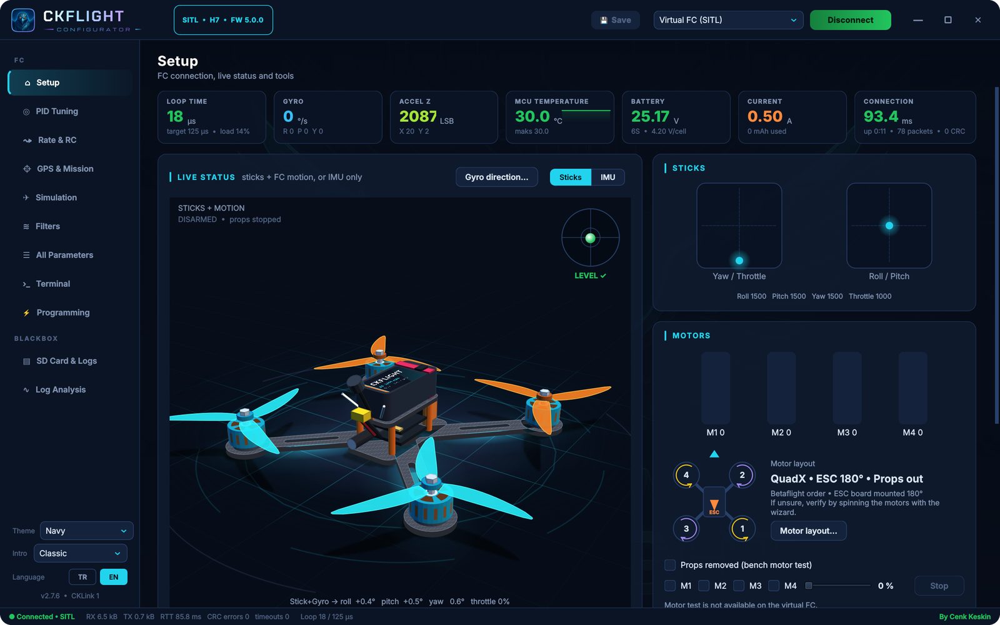
</p>

<table>
<tr>
<td width="50%" align="center">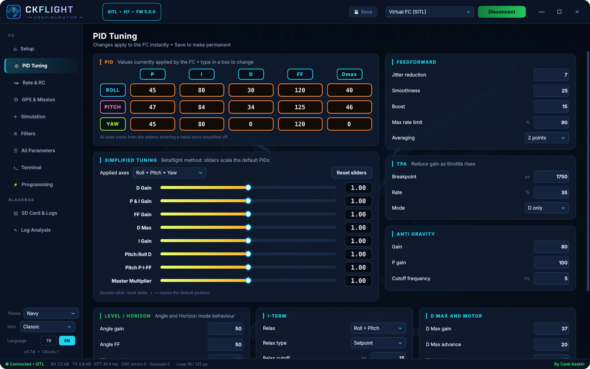<br><b>PID tuning</b><br><sub>Live PID table, simplified sliders, feedforward, TPA, anti-gravity</sub></td>
<td width="50%" align="center">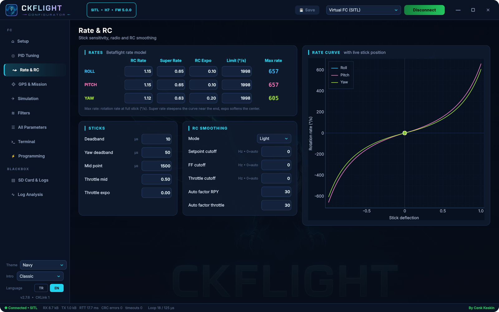<br><b>Rates and RC</b><br><sub>Rate curves with live stick position, RC smoothing</sub></td>
</tr>
<tr>
<td width="50%" align="center">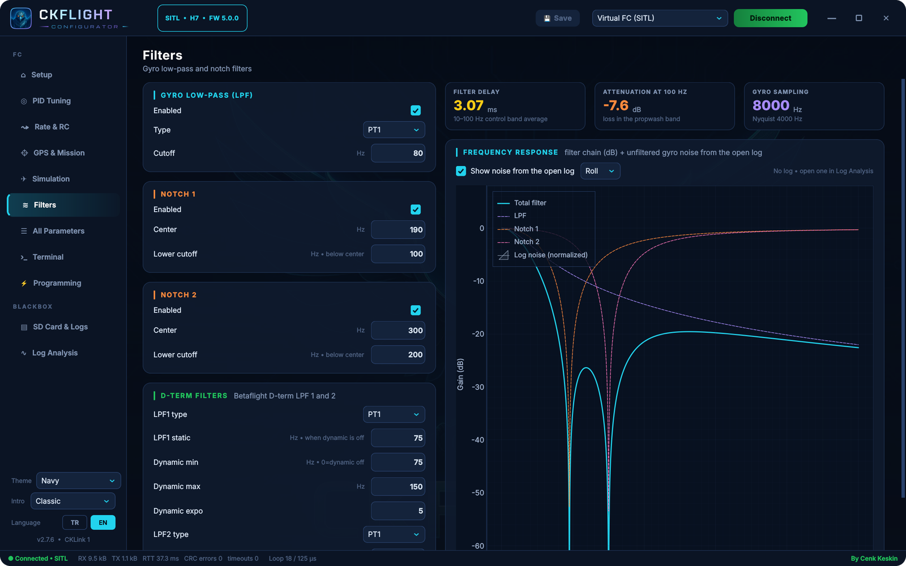<br><b>Filters</b><br><sub>Frequency response and delay of the configured filter chain</sub></td>
<td width="50%" align="center">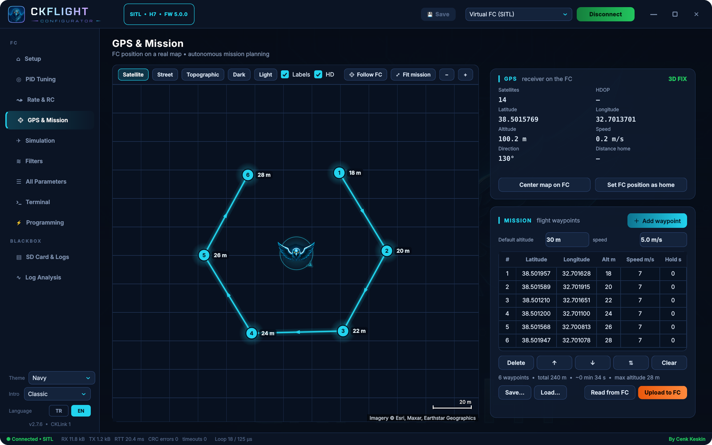<br><b>GPS and mission planner</b><br><sub>Plan waypoints on the map and upload them to the FC</sub></td>
</tr>
<tr>
<td width="50%" align="center">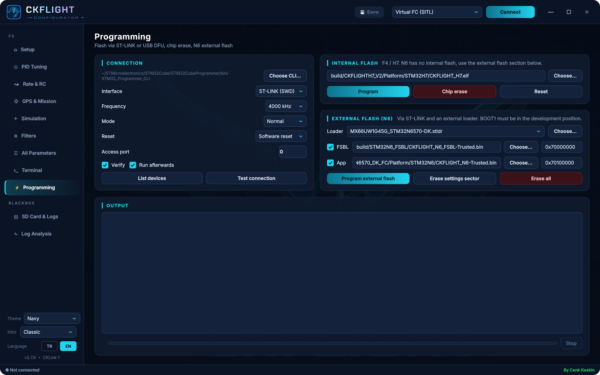<br><b>Programming</b><br><sub>ST-LINK, USB DFU, chip erase and N6 external flash</sub></td>
<td width="50%" align="center">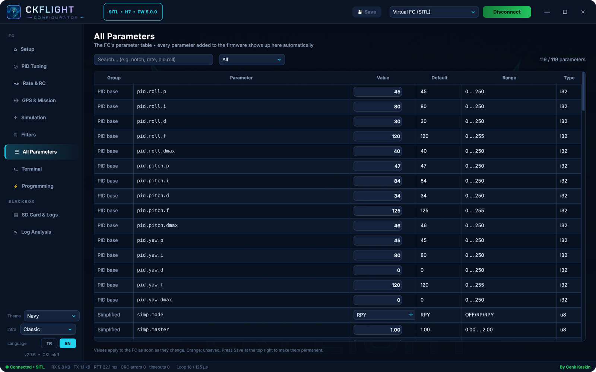<br><b>All parameters</b><br><sub>Generated from the firmware's own table, new parameters appear automatically</sub></td>
</tr>
</table>

<details>
<summary><b>All Configurator pages</b></summary>

| Group | Pages |
|---|---|
| Flight controller | Setup, PID Tuning, Rate & RC, Filters, Modes, Failsafe, Flight Monitor, SD Card & Logs, RGB LED, GPS & Mission, Simulation, All Parameters |
| Blackbox | Log Analysis, Auto Tune |
| AI | AI / NN (STM32N6) |
| Tools | Terminal with one-click commands and a live serial plotter, Programming |

The app runs on Linux and Windows, in English and Turkish, and includes a virtual flight controller (the SITL) so every page can be tried without hardware.

</details>

### Sensors at runtime

`CK_SETTINGS.h` only sets the defaults. Sensors can be switched from the Setup page and take effect after a reboot.

<p align="center">
  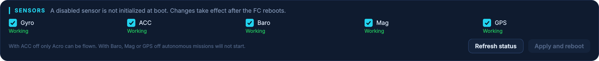
</p>

### CKLink protocol

<p align="center">
  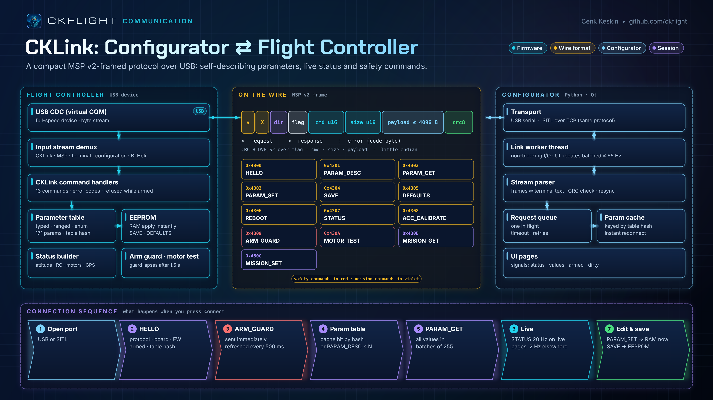
</p>

The Configurator and the FC talk over **CKLink**, a compact MSP v2-framed protocol over USB. The FC describes its own parameter table (name, group, type, range, decimals, options), so a parameter added to the firmware appears in the app without changing the app. Live status, motor test and arm-guard safety commands use the same link.

---

## 🎯 AutoTune

<p align="center">
  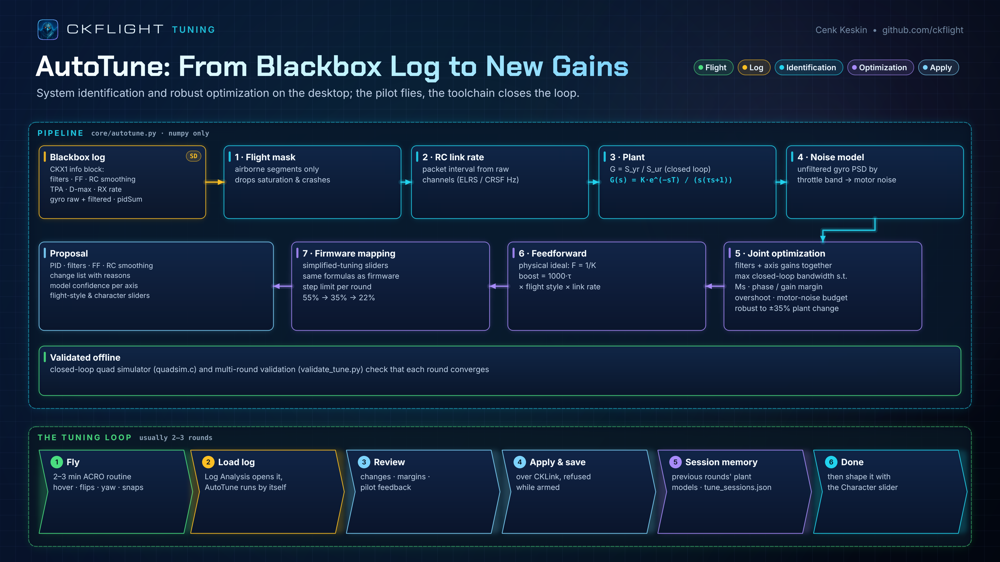
</p>

AutoTune works from your flight logs. It identifies the aircraft's plant (gain, time constant, delay) and noise from a blackbox log, then proposes PID, filter, feedforward and RC smoothing changes round by round. The pilot flies, the toolchain closes the loop.

The method follows a proven manual tuning order:

1. Lower D slightly
2. Find the P and I balance
3. Raise the master gain until oscillation appears, then back off

Feedforward is tuned independently of PID for stick feel. Changes are small per round and oscillations are fixed with small touches in later rounds. PID and filter changes are applied separately, and filters are never made aggressive or noisy during tuning.

<p align="center">
  
</p>

---

## 📈 Blackbox

Logging is designed to be invisible in flight and convenient on the bench:

- Recording starts at the first **ARM** and stops at **DISARM**. Re-arming continues where it left off, so a whole session is one log.
- SD writes go through DMA in a non-blocking state machine and never wait inside the flight loop.
- The default rate is **1/2 of the loop** (4 kHz on H7 and N6, 2 kHz on F4). 1/1, 1/4 and slower can be chosen in the SD Card tab.
- Logs are downloaded over USB from the FC while disarmed. No card reader needed.
- On STM32N6, logs are written by a FileX thread, one `LOG0000.BIN`, `LOG0001.BIN`... per power-up.

Open a flight log in the Configurator and get automatic insights, noise spectra, spectrograms and step response.

<table>
<tr>
<td width="50%" align="center">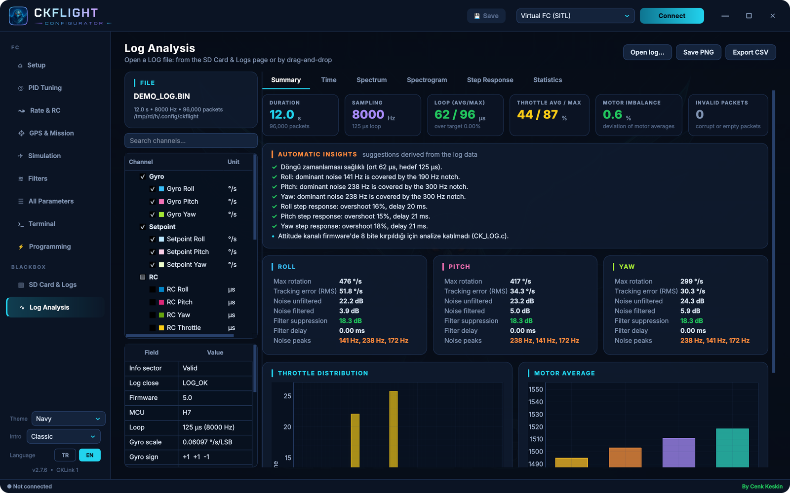<br><b>Summary and insights</b></td>
<td width="50%" align="center">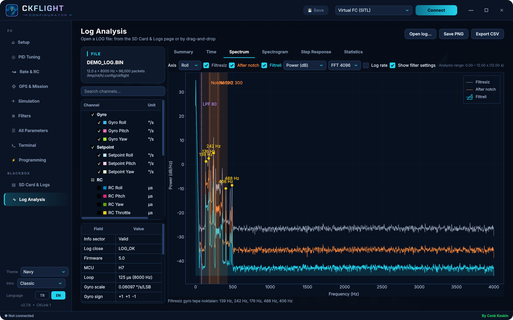<br><b>Noise spectrum</b></td>
</tr>
<tr>
<td width="50%" align="center">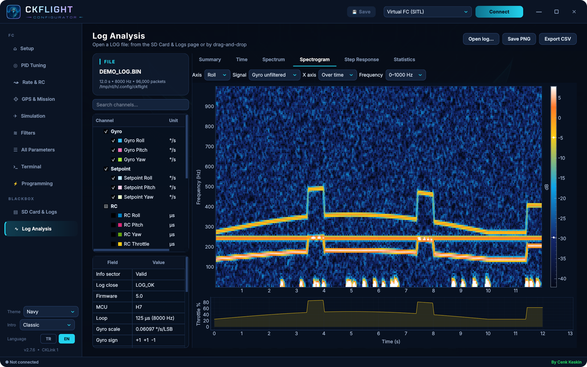<br><b>Spectrogram</b></td>
<td width="50%" align="center">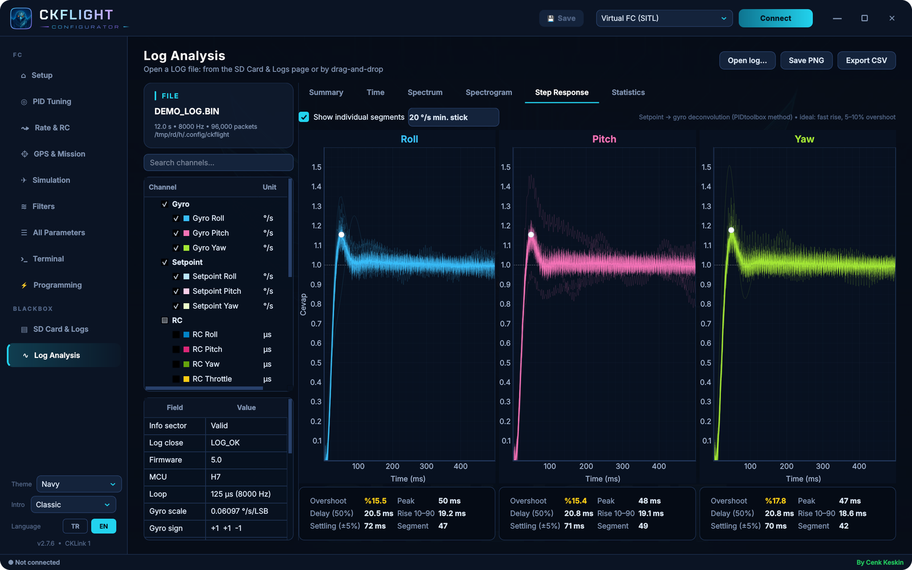<br><b>Step response</b></td>
</tr>
</table>

<sub>The log screenshots above use the app's built-in synthetic demo log.</sub>

A standalone analysis tool is also available: [CKFLIGHT Flight Log Tools](https://github.com/ckflight/Flight_Log_Tools).

---

## ✈ Simulator

The simulator (SITL) compiles the **real firmware** for the PC and flies it against a physics model. No hardware is needed, and it runs inside the Configurator.

<p align="center">
  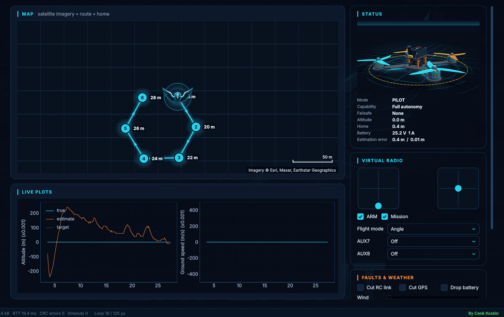
</p>

- Fly with a virtual radio, or run a full mission
- Inject wind, turbulence, RC link loss, GPS loss and low battery
- Compare the true state with the firmware's own estimate, live
- Run automated scenarios with randomized wind and vehicle mass

| Scenario | What it checks |
|---|---|
| `alt_hold`, `pos_hold` | Holding altitude and position in wind |
| `mission`, `land` | Flying a waypoint mission and landing |
| `rth`, `rth_basic`, `rth_switch` | Return-to-home |
| `link_loss`, `link_drop`, `battery` | RC and battery failsafe (`link_drop`: default DROP, no autonomous landing) |
| `fs_reclaim` | Link returns during a failsafe landing: control goes straight back to the pilot |
| `fs_manual` | Blind landing with only gyro and accelerometer |
| `acro_fs` | Link lost during aggressive acro: flips, fast yaw, banked turns |
| `inv_fs`, `flip_level` | Recovery to level from inverted, sideways and after repeated flips |
| `gps_glitch`, `gps_lost` | GPS jumps and permanent GPS loss |
| `level_drift` | Attitude estimate staying level through yaw turns in angle mode |
| `arm_throttle` | Arming refused with throttle high, allowed after the switch is cycled |
| `takeover` | The pilot taking back control |

`tools/sim/run_scenarios.py` runs the core set with randomized seeds and reports pass or fail for each run.

<p align="center">
  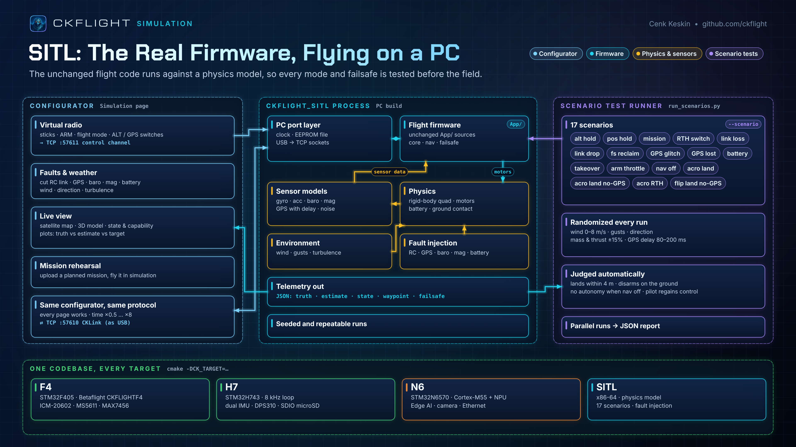
</p>

---

## 🧩 Architecture

<p align="center">
  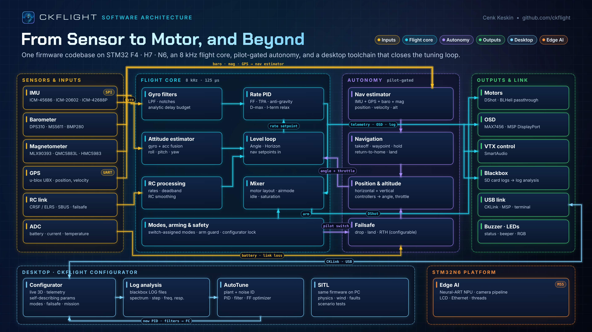
</p>

```text
ckflight/
├── App/            Shared flight code: control, sensors, navigation, CKLink
│   ├── FLIGHT/       PID, mixer, DShot, receiver, modes, failsafe, navigation, blackbox
│   ├── MOTION/       Gyro, accelerometer, IMU, barometer, magnetometer
│   ├── SENSORS/      Device drivers
│   ├── COMMUNICATION/ CKLink, parameters, MSP, terminal
│   └── OSD/          MAX7456 and MSP OSD
├── Platform/       STM32F4, STM32H7, STM32N6, STM32N6_AI and SITL support
├── Bootloader/     STM32N6 first-stage bootloader
├── Targets/        Per-board pins and default settings
├── tools/          Simulator scenarios, unit tests, analysis
├── Configurator/   Desktop application
├── cmake/          ARM GCC toolchain
└── docs/           Notes, build documentation and images
```

**Design rules**

- **One flight code, many platforms.** `App/` never touches a specific MCU. Each `Platform/` provides drivers, and each `Targets/` board provides pins and defaults.
- **The simulator is the firmware.** SITL builds the same `App/` code with stubbed hardware, so a scenario that passes in simulation exercises the code that flies.
- **Proven references.** Algorithms follow Betaflight, INAV, ArduPilot and PX4, and a change goes in only when it demonstrably improves something.

---

## 🔌 Supported hardware

| Target | MCU | Application |
|---|---|---|
| `CKFLIGHTF4_V4` | STM32F4 | Flight controller, also an official Betaflight target (`CKFLIGHTF4`) |
| `REVOLT` | STM32F4 | Flight controller |
| `CKFLIGHTH7_V2` | STM32H7 | Flight controller |
| `KAKUTE_H7_1V3` | STM32H7 | Flight controller |
| `MATEKH743_SLIMV3` | STM32H7 | Flight controller |
| `STM32N6570_DK_FC` | STM32N6 | Flight controller development |
| `STM32N6570_DK` | STM32N6 | AI vision development |
| `SITL` | PC | Simulator |

**Drivers included**

| Type | Devices |
|---|---|
| IMU | ICM20602, ICM45686, ICM42688P, ICM42605, IIM42652, MPU6000, L3GD20H, LSM303D, FXOS8700CQ, BNO055 |
| Magnetometer | MAG3110, LSM303D, FXOS8700CQ, HMC5983, QMC5883L, MLX90393 |
| Barometer | MS5607, BMP280, MS5611, DPS310 |
| GPS | u-blox 7, u-blox 8, M10 series |
| ESC | DShot600, PWM, BLHeli passthrough |
| Receiver | CRSF, SBUS |

The CKFLIGHT hardware family also includes custom ESCs, PDBs and radio transmitter and receiver designs. Availability depends on the board and its configuration. Validate every board before flight.

---

## 🚀 Getting started

### Build the firmware

You need the ARM GNU Toolchain, CMake and Ninja. STM32CubeIDE is not required.

```bash
git clone https://github.com/ckflight/ckflight.git
cd ckflight

cmake -S . -B build/CKFLIGHTH7_V2 -G Ninja \
  -DCMAKE_TOOLCHAIN_FILE=cmake/arm-gcc-toolchain.cmake \
  -DCMAKE_BUILD_TYPE=Debug \
  -DCK_TARGET=CKFLIGHTH7_V2

cmake --build build/CKFLIGHTH7_V2 -j 8
```

Replace `CKFLIGHTH7_V2` with any target from the table above.

### Run the simulator tests

```bash
cmake -S . -B build/sitl -G Ninja -DCK_TARGET=SITL -DCMAKE_BUILD_TYPE=Release
cmake --build build/sitl

python3 tools/sim/run_scenarios.py
```

### Install the Configurator

From a release package on Linux:

```bash
tar xzf CKFLIGHT-Configurator-linux-x86_64.tar.gz
cd CKFLIGHT-Configurator-linux-x86_64
./install.sh            # ./install.sh --remove uninstalls a previous version

sudo usermod -aG dialout $USER   # one time, for USB access; log out and back in
```

Or from the Configurator source folder:

```bash
python3 -m pip install -r requirements.txt
python3 run.py
```

The Programming page uses `STM32_Programmer_CLI`, so install [STM32CubeProgrammer](https://www.st.com/en/development-tools/stm32cubeprog.html) to use it.

### First flight checklist

1. Remove the propellers.
2. Connect the Configurator and check board orientation on the Setup page: the 3D model must follow the aircraft.
3. Check motor order and direction with the motor test. It needs the propellers-removed confirmation and only runs disarmed.
4. Assign the ARM switch and flight modes in Modes, and set the link-loss action in Failsafe.
5. Disconnect the Configurator. Arming is blocked while it is connected.
6. Arm with throttle low and confirm all four motors idle, then disarm. Only then fit the propellers.

### Add a new flight controller

Each board has a directory under `Targets/`:

```text
Targets/CKFLIGHTH7_V2/
├── target.cmake     MCU family and build options
├── CK_CONFIG.h      Pins, peripheral mapping and loop rates
└── CK_SETTINGS.h    Default sensors and features
```

Copy a similar target, adjust the pins, and build it with `-DCK_TARGET=<name>`. Check every peripheral and flight-critical function before flying.

<details>
<summary><b>STM32N6 boot and flash layout</b></summary>

STM32N6 has no internal flash. A first-stage bootloader (FSBL) loads the application from external NOR flash into RAM.

| Address | Content |
|---|---|
| `0x70000000` | FSBL (`CKFLIGHT_N6_FSBL-Trusted.bin`) |
| `0x70100000` | Application (`CKFLIGHT_N6-Trusted.bin`) |
| `0x77FF0000` | Flight controller settings |

Build the FSBL separately:

```bash
cmake -S Bootloader/STM32N6 -B build/STM32N6_FSBL -G Ninja \
  -DCMAKE_TOOLCHAIN_FILE=cmake/arm-gcc-toolchain.cmake \
  -DCMAKE_BUILD_TYPE=Debug

cmake --build build/STM32N6_FSBL -j 8
```

Both images can be written from the Configurator's Programming page with the `MX66UW1G45G_STM32N6570-DK` external loader.

</details>

<details>
<summary><b>STM32N6 AI vision platform</b></summary>

- STM32N6570 Cortex-M55 platform with hardware-accelerated neural network inference
- OV5640 camera through DCMIPP
- BlazeFace face detection, face classification and recognition, face feature extraction (Re-ID)
- LCD visualization and overlays
- Ethernet TCP with NetX Duo and USBX CDC
- External XSPI flash and PSRAM
- The flight loop runs as the highest-priority ThreadX thread; AI, camera and LCD use the remaining CPU time

</details>

<details>
<summary><b>Terminal interface</b></summary>

https://github.com/user-attachments/assets/535e39e9-0e48-4be0-abaf-20bba0b0e894


</details>

---

## 📍 Project status

| Component | Status |
|---|---|
| STM32F4 and STM32H7 flight control | ✅ Flying |
| Synchronous DShot and motor output safety | ✅ Flying |
| Configurator | ✅ Available |
| SITL simulator | ✅ Available |
| Autonomous navigation | 🧪 Verified in simulation, field testing in progress |
| AutoTune | 🧪 New |
| Configurator programming page | 🧪 New |
| STM32N6 flight controller target | 🧪 Flight testing |
| STM32N6 AI vision application and FSBL | ✅ Functional |
| STM32N6 AI and flight controller integration | 📝 Planned |

---

## ⚠️ Disclaimer

CKFLIGHT is intended for educational, experimental and research purposes.

Flight controller firmware operates safety-critical hardware. You are responsible for validating board configurations, sensors, motor direction and failsafe behaviour. Remove propellers during bench tests, and do not fly untested firmware without appropriate safety precautions.

<p align="center">
  
</p>

<p align="center">
  <b>By Cenk Keskin</b> · <a href="https://www.linkedin.com/in/cenkkeskin">LinkedIn</a>
</p>
